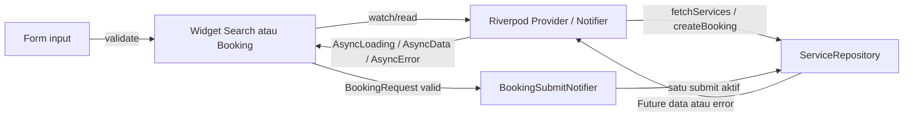

# State management: Search and Booking

Dokumen ini menjelaskan dua feature prototype yang dapat ditunjukkan kepada
reviewer: pencarian jasa dan pembuatan booking. Keduanya menggunakan
`flutter_riverpod` 2.6.1 dan repository lokal agar alurnya dapat dijalankan tanpa
akun atau konfigurasi Supabase.

## Lokasi kode

| Tanggung jawab | File |
| --- | --- |
| Daftarkan Riverpod di root | `lib/main.dart` (`ProviderScope`) |
| Model layanan dan permintaan booking | `lib/features/services/domain/service_item.dart`, `lib/features/booking/domain/booking_request.dart` |
| Kontrak repository dan data demo | `lib/features/services/data/service_repository.dart` |
| Provider, query/filter, fetch dan retry | `lib/features/services/application/service_providers.dart` |
| State submit booking dan penjaga double submit | `lib/features/booking/application/booking_submit_provider.dart` |
| UI search/filter dan empty/error/retry | `lib/features/services/presentation/service_search_page.dart` |
| Form booking, validasi, submit dan state UI | `lib/features/booking/presentation/booking_page.dart` |
| Widget test | `test/features/services/`, `test/features/booking/` |

## Aliran data



`ServiceSearchNotifier` mengambil daftar layanan. `AsyncValue` dari Riverpod
menjadi sumber state untuk UI: `loading` menampilkan spinner, `data` menampilkan
hasil atau empty state, dan `error` menampilkan pesan serta tombol retry.
Pencarian teks dan kategori tersimpan pada provider tersendiri, sehingga widget
search tidak menyimpan atau memfilter data repository secara tersembunyi.

Pada booking, widget menangani input dan validasi tampilan. Hanya setelah form
valid widget membentuk `BookingRequest`. `BookingSubmitNotifier` mengubah state
menjadi loading, memanggil repository, lalu mengembalikan state sukses/error.
Tombol dinonaktifkan selama loading; notifier juga menolak pemanggilan kedua
sebagai perlindungan tambahan.

## Kondisi UI yang ditunjukkan

| Kondisi | Perilaku UI | Widget test |
| --- | --- | --- |
| Initial loading | Spinner saat daftar layanan masih diminta | `shows initial loading before services arrive` |
| Data berhasil | Form booking atau hasil pencarian tampil | `shows loaded services and booking form`, `filters loaded services by query` |
| Empty | Pesan saat repository kosong atau filter tidak menemukan hasil | `shows empty state when repository has no services`, `shows empty result when query has no match` |
| Error dan retry | Pesan error; tombol mencoba fetch lagi | `shows error and retry loads services` dan test retry search |
| Validasi form | Layanan dan tanggal wajib dipilih/diisi; format tanggal ISO diperiksa | `form validation blocks an incomplete booking` |
| Submit loading | Spinner pada tombol; tombol disabled dan submit kedua diabaikan | `submit shows loading and ignores a second tap` |

Jalankan pemeriksaan dari root proyek:

```sh
flutter pub get
flutter analyze
flutter test
flutter run -d chrome
```

## Prompt AI yang digunakan

> Implementasikan dua feature Flutter pada prototype JasaDekat: pencarian jasa
> dan proses booking. Gunakan Riverpod dan pola feature-first. Pisahkan model,
> repository, notifier/provider, dan widget. Booking harus menangani loading
> awal, data sukses, empty state, error dengan retry, validasi form, dan loading
> submit yang mencegah double tap. Pencarian harus bisa memfilter data layanan
> dan mempunyai loading, data, empty, error, serta retry. Tambahkan widget test
> untuk state utama dan jelaskan aliran data agar mudah dipresentasikan.

## Bagian yang diperiksa dan disesuaikan manual

- Memastikan interface repository hanya memuat operasi baca layanan dan buat
  booking; widget tidak memanggil data source secara langsung.
- Memeriksa bahwa loading/error/data berasal dari `AsyncValue`, dan tombol
  retry memanggil ulang repository melalui notifier.
- Memeriksa bahwa tanggal dan layanan divalidasi sebelum `BookingRequest`
  dibuat, tombol submit nonaktif selama request, dan notifier memiliki guard
  untuk pemanggilan ganda.
- Menambahkan fake repository dengan `Completer` agar widget test bisa
  mengontrol loading dan submit tanpa mengandalkan waktu jaringan.
- Menghapus widget test counter bawaan Flutter yang tidak sesuai dengan app,
  lalu menggantinya dengan test yang memeriksa feature ini.

## Bukti UI

Screenshot form booking: [`screenshots/booking-form.png`](screenshots/booking-form.png).
Screenshot layar masuk prototype: [`screenshots/login.png`](screenshots/login.png).
Screenshot beranda setelah daftar: [`screenshots/home-service.png`](screenshots/home-service.png).
Screenshot layar daftar: [`screenshots/signup-screen.png`](screenshots/signup-screen.png).
